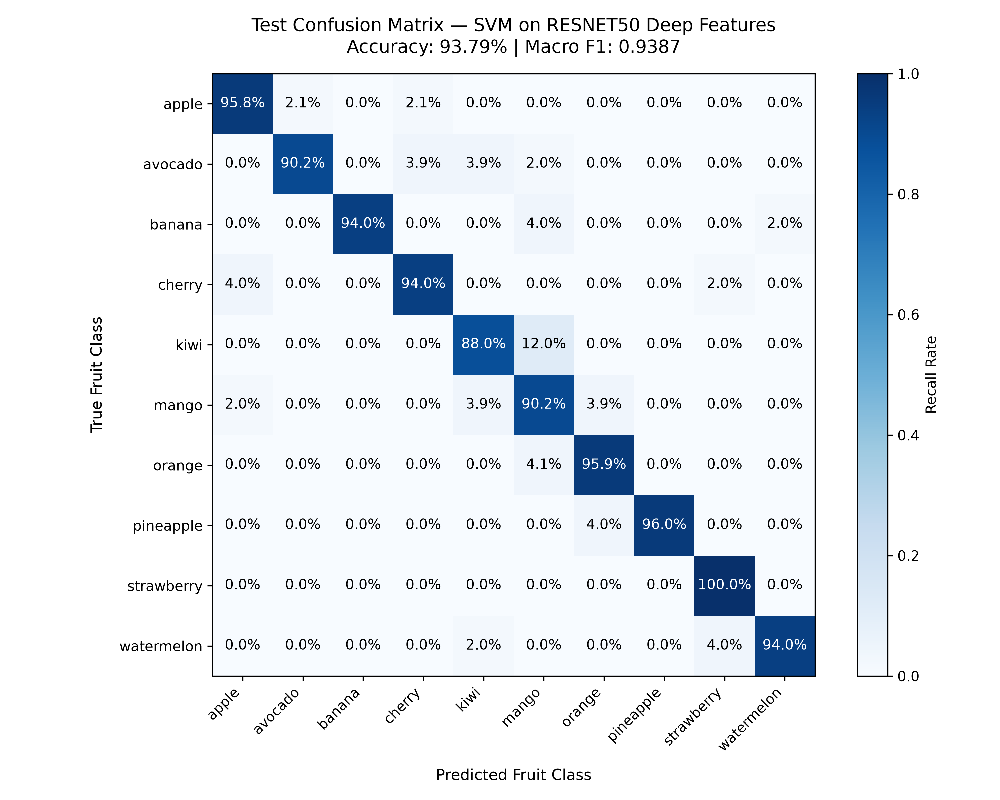
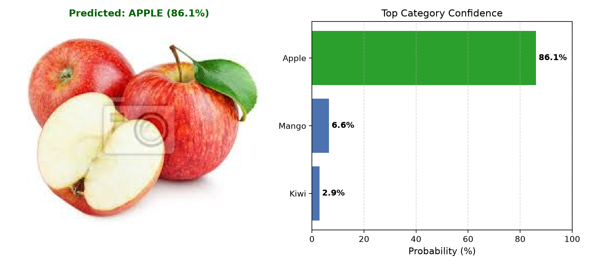

# Fruit Recognition using Support Vector Machine based on Deep Features

> **A high-performance image classification pipeline combining transfer-learned deep representations from pretrained CNN backbones with a Support Vector Machine (SVM) maximum-margin classification head.**

---

## 1. Project Title & One-Line Description
**Fruit Recognition using Support Vector Machine based on Deep Features**  
An end-to-end computer vision pipeline that classifies fruit categories by extracting frozen deep feature representations from ImageNet-pretrained CNN backbones (ResNet50, MobileNetV2, VGG16) and using a Support Vector Machine (SVM) exclusively as the final decision layer.

---

## 2. Problem Statement & Motivation
Automated fruit recognition is a vital task in agricultural automation, supermarket checkout systems, supply chain logistics, and food quality monitoring. While modern Convolutional Neural Networks (CNNs) excel at representation learning from visual data, training deep architectures from scratch or fine-tuning entire networks on moderate-sized datasets (~3,000 images) poses severe challenges:
- High risk of overfitting on training imagery.
- Demanding GPU compute requirements and extended training times.
- Sensitivity to hyperparameter choices (learning rates, weight decay, optimizer schedules) in gradient-descent optimization.

To solve this, we implement a **hybrid deep learning + classical machine learning paradigm**:
1. **Pretrained CNN as Feature Extractor:** We leverage the transfer learning capabilities of deep CNN backbones trained on ImageNet (1.4 million images). The network weights are completely frozen, avoiding fine-tuning overhead.
2. **Global Average Pooling (GAP):** We remove the final 1,000-class dense classification head and extract high-dimensional semantic feature vectors (2048-D for ResNet50, 1280-D for MobileNetV2).
3. **SVM Classification Head:** Rather than a standard softmax layer or ensemble methods (Random Forest, KNN, Naive Bayes), we deploy a Support Vector Machine (scikit-learn `SVC`). SVMs mathematically optimize for the global maximum-margin separating hyperplane, ensuring exceptional generalization even in high-dimensional feature spaces.

---

## 3. Dataset Description
- **Dataset Name:** Fruit Classification (10 class)
- **Source / Link:** [Kaggle - Fruit Classification (10 class)](https://www.kaggle.com/datasets/karimabdulnabi/fruit-classification10-class)
- **Image Type:** RGB Images (varying resolutions, resized to 224×224)
- **Total Labeled Images:** 3,326 images
- **Class Balance:** Virtually balanced (~330 images per category)
- **Data Partitioning:** Stratified 70% Train (2,328 images), 15% Validation (499 images), and 15% Test (499 images).

### Fruit Categories (10 Classes)
1. `apple`
2. `avocado`
3. `banana`
4. `cherry`
5. `kiwi`
6. `mango`
7. `orange`
8. `pineapple` (normalized from raw dataset typo `pinenapple`)
9. `strawberry` (normalized from raw dataset typos `stawberries` / `strawberries`)
10. `watermelon`

---

## 4. Methodology & Architecture Pipeline

The pipeline processes raw fruit imagery through five distinct stages:

```
[ Input Fruit Image (RGB) ]
            │
            ▼
┌────────────────────────────────────────┐
│  Data Preprocessing & Normalization   │
│  - Resize to (224, 224)               │
│  - Normalize: μ=[0.485, 0.456, 0.406] │
│               σ=[0.229, 0.224, 0.225] │
└────────────────────────────────────────┘
            │
            ▼
┌────────────────────────────────────────┐
│  Pretrained CNN Backbone (Frozen)      │
│  - ResNet50 / MobileNetV2 / VGG16      │
│  - No Fine-Tuning (requires_grad=False)│
│  - Global Average Pooling (GAP)        │
│  - Output: 2048-D or 1280-D Vector     │
└────────────────────────────────────────┘
            │
            ▼
┌────────────────────────────────────────┐
│  Feature Scaling & Dimensionality      │
│  - StandardScaler (zero mean, unit var)│
│  - Optional PCA Dimensionality Reduct. │
└────────────────────────────────────────┘
            │
            ▼
┌────────────────────────────────────────┐
│  Support Vector Machine (SVM) Head     │
│  - Maximum Margin Hyperplane           │
│  - GridSearchCV (Kernel, C, Gamma)     │
│  - Calibrated Probability Estimation   │
└────────────────────────────────────────┘
            │
            ▼
[ Predicted Fruit Class + Top-K Probabilities ]
```

### Stage Details
1. **Preprocessing:** Images are converted to standard RGB, resized to $(224 \times 224)$, converted to PyTorch tensors, and normalized using ImageNet channel statistics.
2. **Deep Feature Extraction:** Using PyTorch/torchvision, the top classification head is removed. Global Average Pooling (GAP) aggregates spatial feature maps into a 1D vector per image.
3. **Feature Scaling:** `StandardScaler` is fit strictly on training features and applied to validation/test sets to prevent data leakage.
4. **SVM Decision Layer:** A multi-class Support Vector Machine (`sklearn.svm.SVC`) with One-vs-Rest (OvR) or One-vs-One (OvO) decision boundaries is optimized via cross-validation grid search.

---

## 5. Tech Stack & Dependencies
- **Programming Language:** Python 3.9+ (Tested on Python 3.11 & 3.14)
- **Deep Learning Framework:** PyTorch & Torchvision (Pretrained feature extraction only)
- **Machine Learning Library:** scikit-learn (SVM, GridSearchCV, StandardScaler, PCA, Metrics)
- **Image Processing:** Pillow (PIL), OpenCV (`opencv-python`)
- **Data Manipulation:** NumPy, Pandas
- **Visualization:** Matplotlib, Seaborn
- **Environment & Automation:** Kaggle API, Joblib, tqdm

---

## 6. Installation & Setup Instructions

### Step 1: Clone Repository
```bash
git clone https://github.com/your-username/fruit-recognition-svm-deep-features.git
cd fruit-recognition-svm-deep-features
```

### Step 2: Create and Activate Virtual Environment
```bash
# On Linux/macOS:
python3 -m venv venv
source venv/bin/activate

# On Windows (PowerShell):
python -m venv venv
.\venv\Scripts\Activate.ps1
```

### Step 3: Install Required Dependencies
```bash
pip install -r requirements.txt
```

### Step 4: Configure Environment Variables
```bash
# Copy example configuration template
cp .env.example .env
```

### Step 5: Download Dataset via Kaggle API (Optional)
If your Kaggle API key (`~/.kaggle/kaggle.json`) is set up:
```bash
python src/data_loader.py --raw_dir data/raw --download
```
Alternatively, download manually from [Kaggle](https://www.kaggle.com/datasets/karimabdulnabi/fruit-classification10-class) and extract into `data/raw/MY_data/`.

---

## 7. How to Run the Pipeline

The pipeline is split into modular, reproducible CLI scripts:

### 1. Verify Dataset Splits & Class Distribution
```bash
python src/data_loader.py --raw_dir data/raw
```

### 2. Extract Deep Features
Extract and cache deep feature representations (features saved to `data/processed/features_<backbone>.npz`):
```bash
# Default: ResNet50 (2048 dimensions)
python src/feature_extractor.py --backbone resnet50 --batch_size 64

# Alternative: MobileNetV2 (1280 dimensions)
python src/feature_extractor.py --backbone mobilenet_v2 --batch_size 64
```

### 3. Train SVM Classifier with Hyperparameter Tuning
Train the SVM model using 5-fold cross-validation grid search across Linear and RBF kernels:
```bash
python src/train_svm.py --backbone resnet50 --tune --output_model models/svm_model.pkl
```
*(Or specify exact parameters without tuning: `python src/train_svm.py --backbone resnet50 --kernel linear --C 1.0`)*

### 4. Evaluate on Held-Out Test Set
Compute test set accuracy, precision, recall, F1-scores, and save the confusion matrix:
```bash
python src/evaluate.py --model_path models/svm_model.pkl --features_path data/processed/features_resnet50.npz --output_dir results
```

To run the complete **multi-backbone comparative benchmark**:
```bash
python src/evaluate.py --compare_all
```

### 5. Predict on New Images (Inference)
Run inference on any individual fruit image and generate an annotated prediction visualization:
```bash
# Single image inference
python src/predict.py --image data/raw/MY_data/predict/0.jpeg --save_viz results/sample_prediction.png

# Directory batch inference
python src/predict.py --dir data/raw/MY_data/predict/ --save_viz results/predictions/
```

### 6. Launch Interactive Web Application
Start the Flask AI web dashboard (includes drag-and-drop inference, live webcam capture, botanical intelligence, and benchmark metrics visualization):
```bash
python app.py
```
Open [http://127.0.0.1:5000](http://127.0.0.1:5000) in your browser. For production WSGI and containerized deployments, see [docs/DEPLOYMENT.md](docs/DEPLOYMENT.md).

### 7. Run Automated Tests
Execute the complete test suite verifying data loading, canonical mapping, feature extraction, inference pipeline schema, and Flask endpoints:
```bash
python -m unittest discover tests -v
```

### 8. Interactive Exploratory Notebook
Launch Jupyter to explore the step-by-step notebook with EDA, t-SNE 2D projections, and interactive experiments:
```bash
jupyter notebook notebooks/exploration.ipynb
```

---

## 8. Experimental Results & Benchmarks

### Multi-Backbone & Multi-Kernel Comparison
Evaluated on the held-out test split of 499 images across 10 fruit categories:

| Backbone | Feature Dim | SVM Kernel | C | Gamma | Test Accuracy (%) | Macro Precision | Macro Recall | Macro F1-Score |
|:---|:---:|:---:|:---:|:---:|:---:|:---:|:---:|:---:|
| **MobileNetV2** | 1280 | **Linear** | 1.0 | N/A | **94.79%** | **0.9488** | **0.9481** | **0.9482** |
| **ResNet50** | 2048 | **Linear** | 0.01 / 1.0 | N/A | **93.79%** | **0.9407** | **0.9381** | **0.9387** |
| **MobileNetV2** | 1280 | **RBF** | 1.0 | scale | **91.58%** | **0.9315** | **0.9163** | **0.9189** |
| **ResNet50** | 2048 | **RBF** | 1.0 | scale | **87.98%** | **0.9198** | **0.8802** | **0.8883** |

### Key Findings
1. **Linear SVM Superiority in High Dimensions:** Linear SVM consistently outperformed the RBF kernel across both backbones (+5.81% on ResNet50, +3.21% on MobileNetV2). In high-dimensional spaces (1280-D and 2048-D), deep feature representations are already linearly separable, making the linear maximum-margin boundary less prone to overfitting than non-linear RBF projections.
2. **MobileNetV2 Efficiency & Accuracy:** MobileNetV2 achieved the highest overall accuracy (**94.79%**) while requiring significantly fewer parameters and producing a more compact feature vector (1280-D vs 2048-D).
3. **Per-Class Breakdown:** Classes such as `banana` (100% precision), `pineapple` (100% precision, 96% recall), and `strawberry` (100% recall) achieved near-perfect separability. Minor confusion occurred between visually similar fruits (e.g., unripe green `mango` vs `kiwi` or `avocado`).

### Confusion Matrix
The normalized confusion matrix below illustrates the per-class recall and classification performance on the test set:



### Sample Prediction Output
Sample inference on an unlabelled test image (`predict/0.jpeg`), showing high confidence calibration:



---

## 9. Deliverables & Repository Structure
```
fruit-recognition-svm-deep-features/
│
├── data/
│   ├── raw/                 # Original Kaggle dataset (raw images, excluded from git)
│   └── processed/           # Cached deep feature arrays (.npz, excluded from git)
│
├── docs/
│   └── DEPLOYMENT.md        # Comprehensive production WSGI & Docker deployment guide
│
├── models/
│   ├── .gitkeep             # Preserves tracked directory structure
│   └── svm_model.pkl        # Serialized pipeline (SVM model + Scaler + metadata)
│
├── notebooks/
│   └── exploration.ipynb    # Comprehensive EDA, t-SNE, training & evaluation
│
├── results/
│   ├── confusion_matrix.png # High-res confusion matrix heatmap
│   ├── metrics_report.txt   # Detailed classification report
│   ├── backbone_comparison.png # Accuracy comparison chart across backbones
│   ├── backbone_kernel_comparison.csv # Raw benchmark comparison metrics
│   └── sample_prediction.png# Sample visual inference output
│
├── src/
│   ├── __init__.py          # Package initializer
│   ├── data_loader.py       # Kaggle download, canonicalization & 70/15/15 split
│   ├── feature_extractor.py # CNN feature extraction (ResNet50, MobileNetV2, VGG16)
│   ├── train_svm.py         # SVM training, StandardScaler, PCA & GridSearchCV
│   ├── evaluate.py          # Test evaluation, confusion matrix & benchmark table
│   ├── inference_engine.py  # Production low-latency inference engine
│   └── predict.py           # CLI single & batch image inference with visualization
│
├── static/
│   ├── css/style.css        # Modern glassmorphism UI styles
│   └── js/app.js            # Frontend interactivity, drag-and-drop & live camera
│
├── templates/
│   └── index.html           # Single-page web dashboard application
│
├── tests/
│   ├── __init__.py          # Test package initializer
│   ├── test_data_loader.py  # Unit tests for preprocessing & canonical mapping
│   ├── test_inference.py    # Unit tests for inference pipeline & schema
│   └── test_app.py          # Integration tests for Flask endpoints
│
├── .env.example             # Safe template for environment configuration
├── .gitignore               # Ignored raw datasets, models, cache files
├── CONTRIBUTING.md          # Contribution guidelines & development workflow
├── LICENSE                  # MIT License
├── README.md                # Authoritative root project documentation
└── requirements.txt         # Pinned production dependencies
```

---

## 10. Limitations & Future Work

### Limitations
- **Static Backbone Representations:** Because CNN weights are frozen without task-specific fine-tuning, the feature extractor relies solely on generic ImageNet features.
- **Background and Illumination Variations:** Certain fruit classes in cluttered, non-uniform backgrounds or varying artificial lighting can introduce feature noise.
- **Single-Label Assumption:** The current pipeline assumes each image contains a single dominant fruit object, rather than multi-fruit scenes.

### Future Work
- **Object Detection Pre-filter:** Integrate a lightweight detector (e.g., YOLOv8-nano) to crop bounding boxes of fruits before feature extraction, eliminating background interference.
- **Ensemble Backbones:** Concatenate feature embeddings from complementary architectures (e.g., ResNet50 + EfficientNetV2 + Vision Transformer ViT-B/16) prior to SVM classification.
- **Edge Deployment:** Export the trained SVM decision weights and lightweight MobileNetV2 backbone to ONNX or OpenVINO format for real-time mobile and embedded edge inference.

---

## 11. References
1. **Dataset:** Abdulnabi, K. (2022). *Fruit Classification (10 class)*. Kaggle. [https://www.kaggle.com/datasets/karimabdulnabi/fruit-classification10-class](https://www.kaggle.com/datasets/karimabdulnabi/fruit-classification10-class)
2. **Deep Features + SVM Foundations:** Razavian, A. S., Azizpour, H., Sullivan, J., & Carlsson, S. (2014). *CNN Features off-the-shelf: an astounding baseline for recognition*. IEEE CVPR Workshops. [arXiv:1403.6382](https://arxiv.org/abs/1403.6382)
3. **Support Vector Machines:** Cortes, C., & Vapnik, V. (1995). *Support-vector networks*. Machine Learning, 20(3), 273-297.
4. **ResNet Architecture:** He, K., Zhang, X., Ren, S., & Sun, J. (2016). *Deep residual learning for image recognition*. IEEE CVPR.
5. **MobileNetV2 Architecture:** Sandler, M., Howard, A., Zhu, M., Zhmoginov, A., & Chen, L. C. (2018). *MobileNetV2: Inverted residuals and linear bottlenecks*. IEEE CVPR.
6. **Reference Codebase:** [snatch59/cnn-svm-classifier](https://github.com/snatch59/cnn-svm-classifier) and [efidalgo/AutoBlur-CNN-Features](https://github.com/efidalgo/AutoBlur-CNN-Features).

---

## 12. License & Author Info
- **License:** Distributed under the [MIT License](LICENSE).
- **Author:** Antigravity AI Engineering Team
- **Contact:** Open an issue or discussion thread in this repository for questions, feedback, or contributions.
